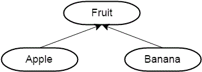
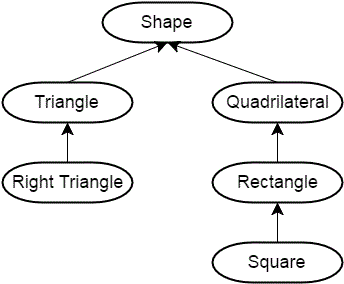
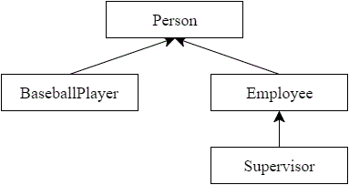

# Introduction to Inheritance

Unlike object composition, which involves creating new objects by combining and connecting other objects, inheritance involves creating new objects by directly acquiring the attributes and behaviors of other objects and then extending or specializing them.

Inheritance in C++ takes place between classes. In an inheritance (is-a) relationship, the class being inherited from is called the **parent class**, **base class**, or **superclass**, and the class doing the inheriting is called the **child class**, **derived class**, or **subclass**.

- **Base Class**: This is the class whose properties and methods are inherited by another class. It is also known as the parent class or superclass.

- **Derived Class**: This is the class that inherits the properties and methods of another class. It is also known as the child class or subclass.

In the diagram below, Fruit is the parent, and both Apple and Banana are children:



In this diagram, Triangle is both a child (to Shape) and a parent (to Right Triangle):



## Access specifier

To inherit a class, you need to use the `:` symbol followed by the access specifier and then the class you want to inherit.

```c++
class DerivedClass : access_specifier BaseClass
{
};
```

Inheritance can be of the following types based on the access specifier used:

- **Public Inheritance**: 
	- The public members of the base class become public members
	- The protected members of the base class become protected members 
	- Private members of the base class are not accessible in the derived class.

- **Protected Inheritance**: 
	- Both the public and protected members of the base class become protected members of the derived class. 
	- Private members of the base class are not accessible in the derived class.

- **Private Inheritance**: 
	- Both the public and protected members of the base class become private members of the derived class. 
	- Private members of the base class are not accessible in the derived class.

## The person



```c++
#include <iostream>
#include <string>
#include <string_view>

class Person
{
public:
    std::string m_name{};
    int m_age{};

    Person(std::string_view name = "", int age = 0)
        : m_name{name}, m_age{age}
    {
    }

    const std::string& getName() const { return m_name; }
    int getAge() const { return m_age; }

};

// Employee publicly inherits from Person
class Employee: public Person
{
public:
    double m_hourlySalary{};
    long m_employeeID{};

    Employee(double hourlySalary = 0.0, long employeeID = 0)
        : m_hourlySalary{hourlySalary}, m_employeeID{employeeID}
    {
    }

    void printNameAndSalary() const
    {
        std::cout << m_name << ": " << m_hourlySalary << '\n';
    }
};

class Supervisor: public Employee
{
public:
    // This Supervisor can oversee a max of 5 employees
    long m_overseesIDs[5]{};
};

int main()
{
    Employee frank{20.25, 12345};
    frank.m_name = "Frank"; // we can do this because m_name is public
    frank.printNameAndSalary();

    return 0;
}
```

Output:
```
Frank: 20.25
```

### Why is this kind of inheritance useful?

Inheriting from a base class means we don’t have to redefine the information from the base class in our derived classes. We automatically receive the member functions and member variables of the base class through inheritance, and then simply add the additional functions or member variables we want. This not only saves work, but also means that if we ever update or modify the base class (e.g. add new functions, or fix a bug), all of our derived classes will automatically inherit the changes!

For example, if we ever added a new function to Person, then Employee, Supervisor, and BaseballPlayer would automatically gain access to it. If we added a new variable to Employee, then Supervisor would also gain access to it. This allows us to construct new classes in an easy, intuitive, and low-maintenance way!